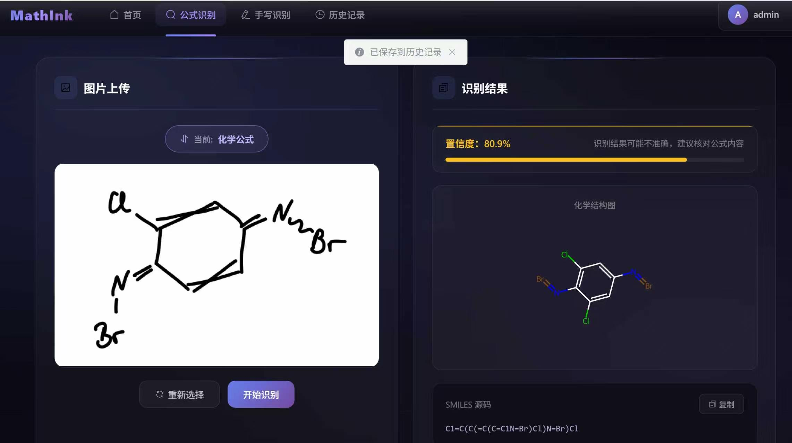
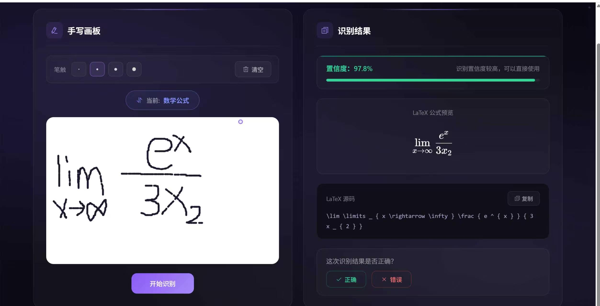

## Uni-MuMER 论文复现完整报告

### 一、任务概述

**目标**：在 22GB 显存限制下，用 Qwen3.5-0.8B 模型复现 Uni-MuMER 论文的多任务手写公式识别方法，并做出改进。

---

### 二、创新点

#### 1. 数据存储优化（数据预处理阶段）

**原论文问题**：
- 同一图片复制 4 份（原始、can、error_find、error_fix、tree 共 5 种任务变体）
- 存储空间浪费 5 倍

**改进方案**：
- **统一格式**：将 jpg/png 统一转为 **WebP** 格式（减少体积 30-50%）
- **内容哈希命名**：相同图片只存储一份
- **共享目录**：多个 JSON 引用同一图片文件，不重复存储
- **效果**：存储空间降低约 80%

#### 2. 极低 LoRA Rank 训练（显存优化）

**配置**：
- `lora_rank=4, lora_alpha=8`
- 可训练参数仅 **270 万**（占总参数 0.32%）

**效果**：在 22GB A10 上完成 0.8B 多模态模型训练

#### 3. 分阶段课程学习（训练策略）

**第一阶段**：基础能力训练
- 数据集：crohme2023 系列 5 个（原始 + can + error_find + error_fix + tree）
- 学习率：5e-5，训练 8,333 步，loss 0.0828

**第二阶段**：空间感知增强
- 动机：实测发现复杂嵌套公式识别错误（上标范围误判）
- 数据集：`hme100k_train_tree-00001` + `crohme_train_tree` + `crohme_train`（2 tree + 1 原始混合）
- 学习率：**5e-6**（降低 10 倍，防止灾难性遗忘）
- Dropout：0.1（正则化）
- 通过 `adapter_name_or_path` 从上一阶段继续训练

---

### 三、显存优化策略汇总

| 策略 | 具体设置 | 作用 |
|------|---------|------|
| 极低 LoRA rank | rank=4, alpha=8 | 可训练参数降 8 倍 |
| 梯度检查点 | gradient_checkpointing=true | 显存降 40-50% |
| 混合精度 | fp16/bf16 | 显存降 50% |
| 批次大小调优 | batch_size=6（经 8→12→7→6 尝试） | 平衡显存与速度 |
| 显存碎片整理 | PYTORCH_CUDA_ALLOC_CONF | 减少 OOM |
| Dropout | lora_dropout=0.1 | 正则化 |

---

### 四、最终结果

| 数据集 | 0.8B（本工作） | 论文 3B Vanilla | 差距 | 评语 |
|--------|--------------|----------------|------|------|
| CROHME 2014 | 68.66% | 72.62% | -3.96% | 接近 |
| CROHME 2016 | **69.50%** | 64.26% | **+5.24%** | 超越 |
| CROHME 2019 | 66.50% | 69.14% | -2.64% | 接近 |
| HME100K | 49.00% | 70.15% | -21.15% | 短板 |

---

### 五、自我评价

#### 成功之处
1. ✅ 22GB 显存限制下完整跑通训练流程
2. ✅ CROHME 2016 超越 3B 基线 5.24%
3. ✅ 用 1/4 参数量达到接近效果
4. ✅ 数据存储优化（WebP + 内容哈希 + 共享目录）
5. ✅ 训练时间可控（每阶段 3-4 小时）

#### 不足之处
1. ❌ HME100K 真实场景泛化不足（-21.15%）
2. ❌ 空间感知部分改善但未完全解决
3. ❌ LoRA rank=4 限制了模型容量

---

### 六、优化空间

#### 短期改进
1. 增加 HME100K 训练数据占比
2. 在 MNE 测试集上量化空间感知问题
3. 换 A100 40GB 用 rank=16 或 32 重训

#### 中期改进
1. 数据增强（手写风格迁移、噪声注入、几何变换）
2. 课程学习（按难度排序渐进训练）
3. 多任务损失权重调优
4. 后处理结构校正（括号匹配、上标范围规则）

#### 长期改进

**微调策略升级**：
- 全参数微调（A100 40GB+）
- 增大 LoRA rank（16/32/64）
- QLoRA（4-bit 量化 + LoRA）
- 其他 PEFT 方法（Adapter、Prefix Tuning）

**模型架构**：
- 换更大模型（Qwen3.5-2B/4B）
- 视觉编码器专门微调（适应公式识别）

**训练效率**：
- 多 GPU 并行（数据并行/模型并行）
- DeepSpeed ZeRO
- 混合精度自适应

---

### 七、结论

**论文复现基本成功**。在 22GB 显存约束下，通过数据存储优化、极低 LoRA rank（rank=4）、分阶段课程学习，用 0.8B 模型在 CROHME 系列达到接近甚至超过 3B 基线的效果（2016 超越 5.24%）。主要短板是真实场景（HME100K）的泛化。

**核心贡献**：
1. 小模型潜力验证：证明 0.8B 模型在多任务手写公式识别中具有不输 2B/3B 模型的潜力（CROHME 2016 超越 3B 基线 5.24%）
2. 极低 LoRA rank 训练可行性：验证 rank=4（可训练参数仅 270 万）在 22GB 显存下有效训练多模态模型
3. 数据存储优化：提出 WebP 格式统一 + 内容哈希命名 + 共享目录，解决原论文多任务数据复制导致的存储浪费

### 八、命令

**训练命令**：

pip install transformers==5.2.0

pip install torch==2.4.0

pip install torchvision==0.19.0

pip install torchaudio==2.4.0

pip install peft

pip install trl==0.24.0

pip install datasets accelerate omegaconf

pip install "numpy<2"

pip install "scipy<1.13"

cd /mnt/workspace/LLaMA-Factory

export PYTHONPATH=/mnt/workspace/LLaMA-Factory/src:$PYTHONPATH

nohup env DISABLE_VERSION_CHECK=1 python -m llamafactory.cli train train_tree_continue.yaml > /mnt/workspace/LLaMA-Factory/train_tree_cpu.log 2>&1 &

tail -f /mnt/workspace/LLaMA-Factory/train_tree_cpu.log

**评估命令**：

pip install transformers==5.2.0

pip install torch==2.4.0

pip install torchvision==0.19.0

pip install torchaudio==2.4.0

pip install peft

pip install editdistance

pip install "numpy<2"

pip install "scipy<1.13"

### 九、演示

